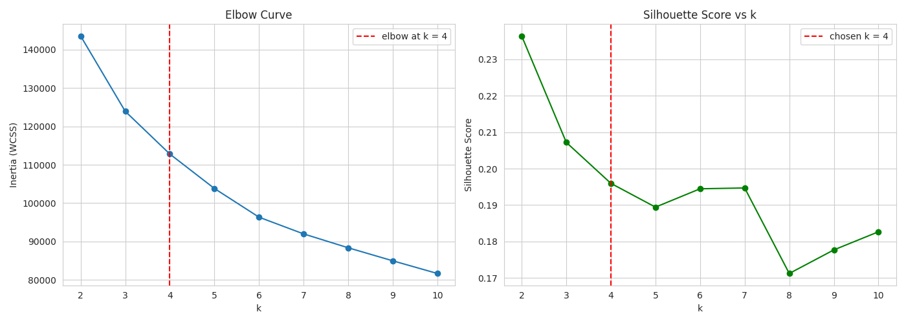
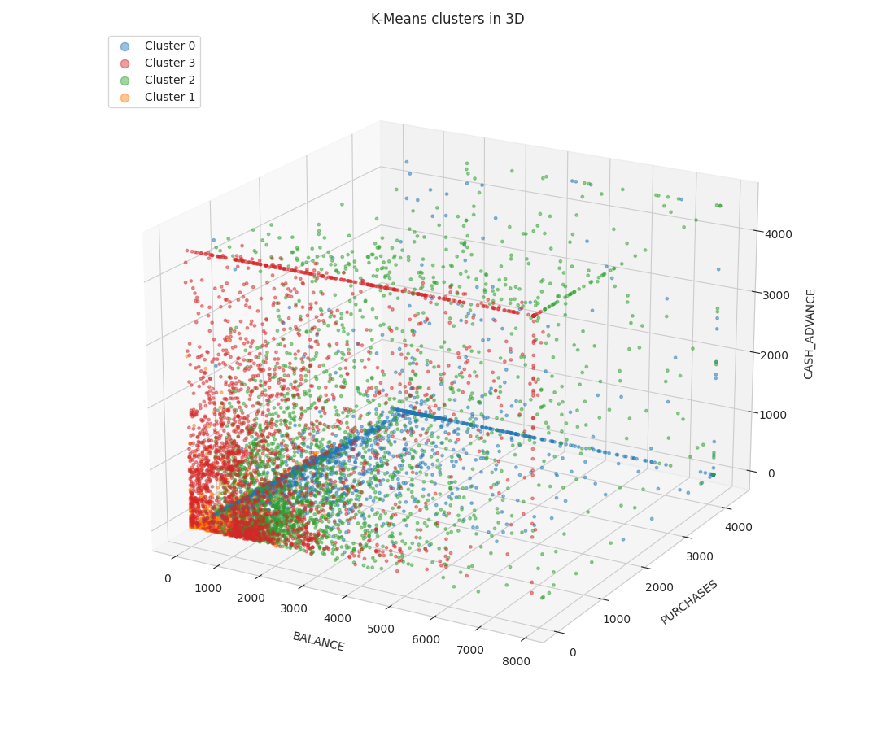
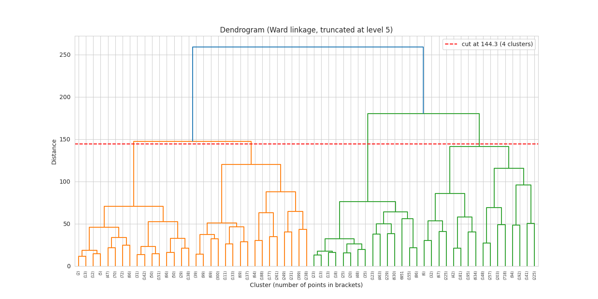
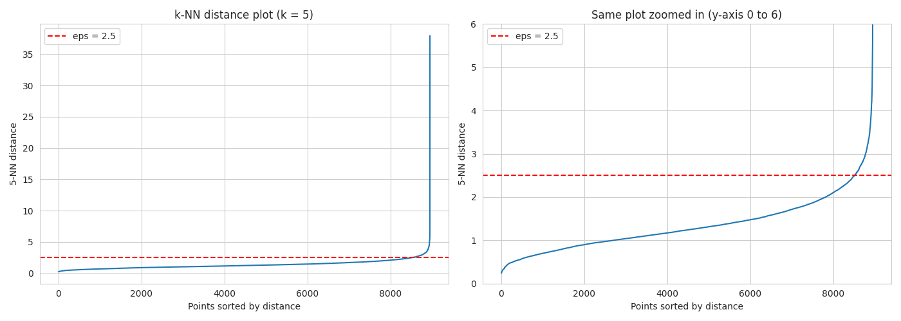
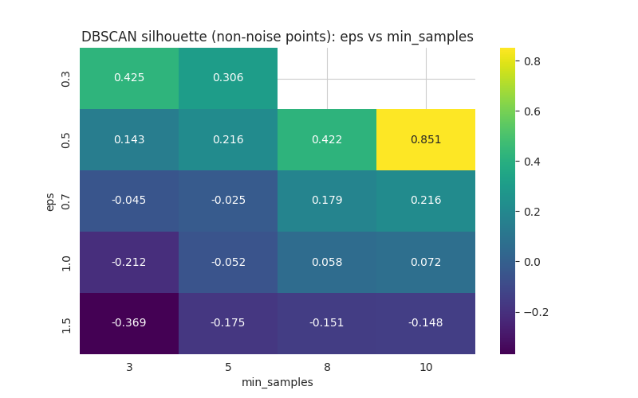
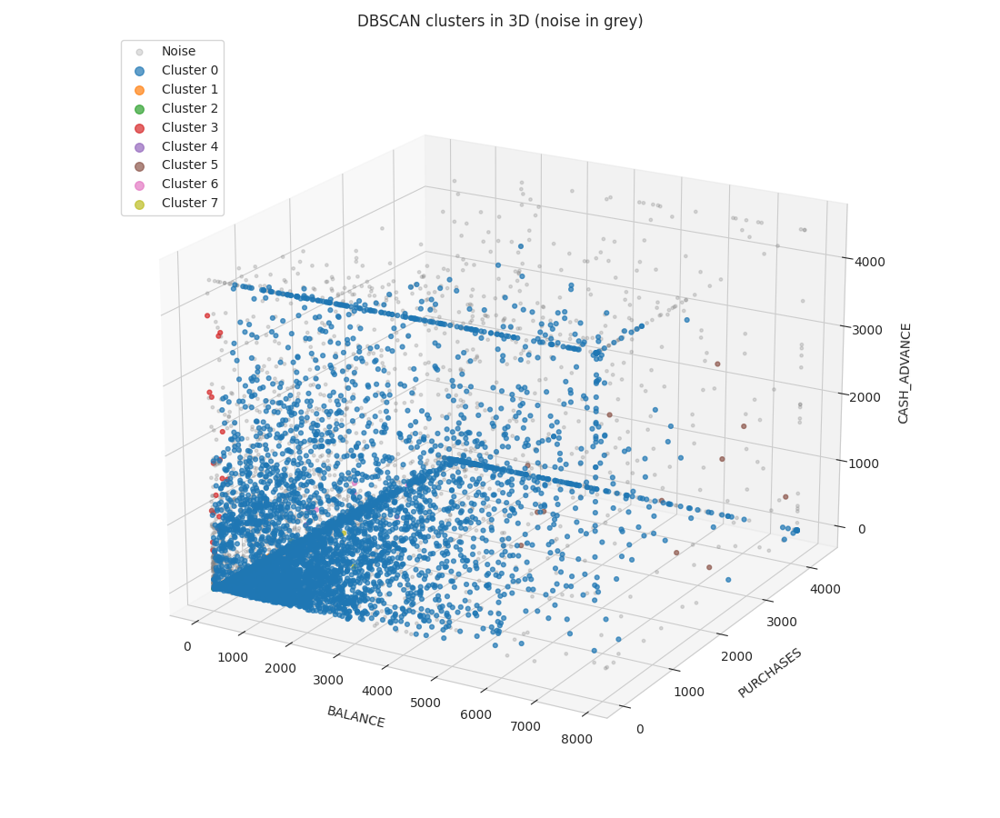

# Credit Card Customer Segmentation - Unsupervised Learning

Practical Exam (Set C) - Red & White Skill Education

## Project Overview
The credit cards division of an Indian private bank wants to move away from one-size-fits-all card offers. In this project I engineer behavioural features from credit card usage data and group cardholders into segments using three clustering algorithms - **K-Means**, **Agglomerative Hierarchical Clustering** and **DBSCAN** - and then turn the clusters into business personas.

## Dataset
Credit Card Dataset for Clustering (Kaggle): https://www.kaggle.com/datasets/arjunbhasin2013/ccdata
- 8,950 cardholders, 18 columns (`CC_GENERAL.csv`, included in this repo)
- `CUST_ID` is dropped; missing `CREDIT_LIMIT` and `MINIMUM_PAYMENTS` are filled with the median

## Repository Files
| File | Description |
|---|---|
| `CreditCardSegmentation_UnsupervisedLearning.ipynb` | Fully executed notebook (Steps 1-7) |
| `CC_GENERAL.csv` | Dataset |
| `cc_scaler.pkl` | Saved `StandardScaler` |
| `cc_segmentation_model.pkl` | Saved final K-Means model |
| `summary_report.md` | Short project report |
| `requirements.txt` | Python libraries |
| `images/` | Screenshots used in this README |

## How to Run
```bash
git clone https://github.com/<your-username>/creditcard-segmentation-unsupervised-learning.git
cd creditcard-segmentation-unsupervised-learning
pip install -r requirements.txt
jupyter notebook CreditCardSegmentation_UnsupervisedLearning.ipynb
```
Run all cells from top to bottom. The notebook was developed with Python 3.12 and scikit-learn 1.8.0. If you load the `.pkl` files in a different scikit-learn version, you may get a version warning, so re-running the notebook to regenerate them is the safest option.

## Method (short)
1. EDA: histograms (log scale), correlation heatmap, utilisation ratio, top cash-advance customers, Pareto check (26.2% of customers drive 80% of purchases).
2. Feature engineering: `Monthly_Avg_Purchase`, `Monthly_Avg_Cash_Advance`, `Limit_Usage`, `Payment_to_Minpayment_Ratio`.
3. Preprocessing: IQR winsorization (Q3 + 3 x IQR), `log1p` on monetary columns, `StandardScaler` on 21 features.
4. K-Means (elbow + silhouette, k = 4), Agglomerative (dendrogram cut at 4 clusters, Ward/complete/average compared), DBSCAN (k-NN distance plot, eps x min_samples grid).
5. Comparison with Silhouette, Davies-Bouldin and Calinski-Harabasz, K-Means stability check over 5 seeds, saved pipeline and `predict_segment()` function.

## Results
| Algorithm | Clusters | Silhouette | Davies-Bouldin | Calinski-Harabasz | Noise % |
|---|---|---|---|---|---|
| K-Means (k=4) | 4 | 0.196 | 1.71 | 1,987 | 0 |
| Agglomerative (Ward, n=4) | 4 | 0.138 | 1.98 | 1,422 | 0 |
| DBSCAN (eps=1.5, min_samples=10) | 8 | -0.148 | 1.23 | 35 | 28.4 |

K-Means is the recommended model: best silhouette and Calinski-Harabasz, stable across seeds (0.1959 +/- 0.00007), and it can score new customers. DBSCAN's metrics are calculated on non-noise points only, so they are not directly comparable.

## Cluster Personas (K-Means)
| Persona | Customers | Description | Suggested action |
|---|---|---|---|
| Premium Transactors | 1,655 | Highest limit and purchases, buy almost every month, often pay in full | Upgrade to premium rewards card, limit increase |
| Revolvers | 2,325 | Highest balance and minimum payments, 67% limit usage, 2% pay in full | Balance-transfer / EMI conversion offer |
| Cash-Advance Reliant | 2,319 | Almost no purchases, highest cash advance | Risk watch-list, cheaper personal loan, first-purchase rewards |
| Low-Activity Cardholders | 2,651 | Lowest balance, limit and payments, 7% limit usage | Reactivation offer, annual-fee waiver on spend target |

## Screenshots
**K-Means elbow curve and silhouette score**


**K-Means clusters in 3D (BALANCE vs PURCHASES vs CASH_ADVANCE)**


**Dendrogram with the cut line (4 clusters)**


**DBSCAN k-NN distance plot**


**DBSCAN eps vs min_samples silhouette heatmap**


**DBSCAN clusters in 3D (noise in grey)**

